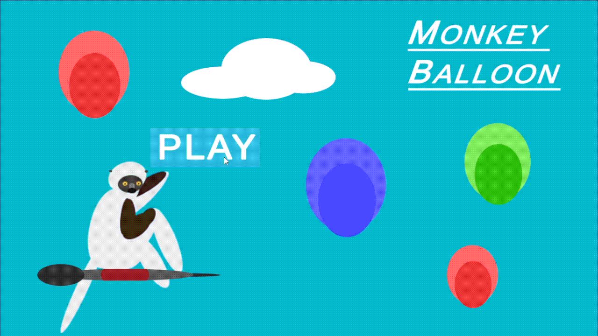

# 🎮 [MONKEY BALLON]

Eres un mono que tira un proyectil(dardo) y como objetivo tienes que explotar todos los globos del nivel.

* ⏳ **Tiempo de desarrollo:** [1 semana]
* 🛠️ **Estado:** [Completado]

---

## 🛠️ Tecnologías Utilizadas

Este proyecto ha sido desarrollado e integrado combinando las siguientes herramientas clave:
* **Unity Hub:** Utilizado para la gestión del proyecto, control de versiones del motor y la configuración del entorno de desarrollo.
* **JavaScript:** El lenguaje principal empleado para la programación de la lógica, mecánicas y comportamiento general del videojuego.

---

## 📦 Estructura del Repositorio y Ejecución

Para facilitar la revisión del proyecto, la carpeta está organizada de la siguiente manera:

### 1. 📜 Revisión de Código (Scripts Separados)
Dentro de esta carpeta encontrarás los **scripts organizados y separados** de forma independiente. Esto permite abrir, leer y analizar directamente el código fuente y la arquitectura de las funciones sin necesidad de importar todo el proyecto a Unity.

### 2. 🚀 Instalador Directo (Jugar de inmediato)
Si solo quieres probar el videojuego en tu computadora, no necesitas compilar nada:
* Busca el archivo ejecutable **`Setup (x64).exe`** en la carpeta principal.
* Haz doble clic en él para iniciar el asistente de instalación.
* Sigue los pasos en pantalla y el juego se instalará directamente en tu sistema Windows de 64 bits.

---

## 🚀 Características Principales del Juego
* **[Mecánica 1]:** Breve descripción (Mantener apretado el click muestra una barra de poder).
* **[Mecánica 2]:** Breve descripción (El objeto(Dardo) tiene una trayectoria parabólica y gira su angulo de posicion en base a su posición).
---